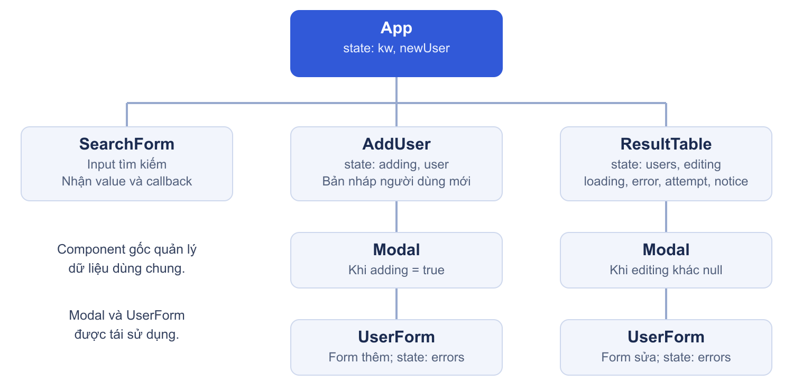
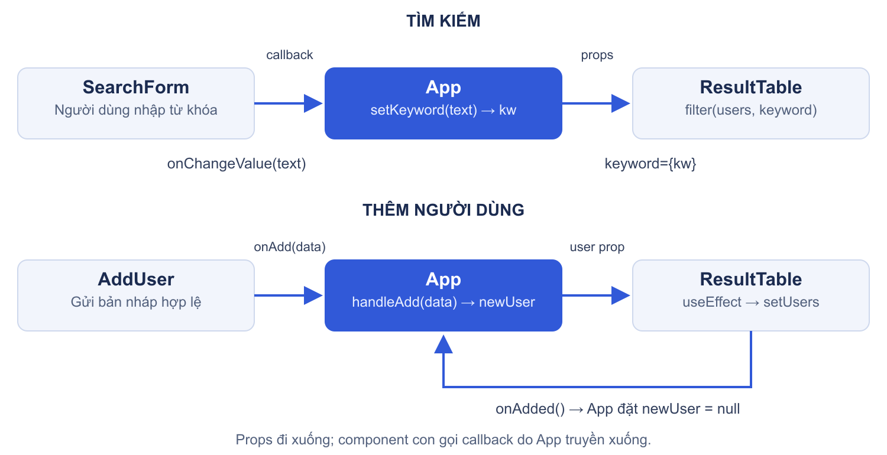

# React CRUD - IT4409

Ứng dụng quản lý người dùng theo tài liệu **Ex. React-CRUD - 20261.pdf**.

- [Ứng dụng trên tên miền cá nhân](http://www.dunglq09.id.vn/react-crud/)
- [Thông tin nộp bài](NOP_BAI.md)

Báo cáo Word độc lập (`.docx`) được bàn giao riêng để người làm bài tự tải lên
và điền link nộp bài. Toàn bộ sơ đồ và ảnh minh họa được nhúng trong file.

## Chức năng

Tải danh sách từ JSONPlaceholder; tìm theo họ tên hoặc username (không phân
biệt hoa/thường và dấu tiếng Việt); thêm, sửa, xóa người dùng; kiểm tra trường
bắt buộc và email; xử lý lỗi API với nút thử lại. Form hỗ trợ bàn phím,
Escape, focus và màn hình điện thoại. Bảng cuộn ngang trong vùng riêng trên
màn hình nhỏ.

Dữ liệu thay đổi chỉ được giữ trong state của phiên hiện tại. Tải lại trang
sẽ tải lại danh sách từ API. Không gửi POST/PUT/DELETE lên server.

## Cấu trúc theo đề

`App` giữ `kw`, `newUser`; `SearchForm`, `AddUser`, `ResultTable` là ba con trực
tiếp. `AddUser` giữ bản nháp form; `ResultTable` giữ danh sách và bản nháp sửa.
`Modal` và `UserForm` là hai thành phần dùng chung.





## Chạy và build

Từ thư mục gốc repository, chạy `npm start`, mở
`http://127.0.0.1:4173/react-crud/`. Bản build đã được lưu tại `assets/`,
không cần npm install để xem hoặc triển khai.

Để sửa và biên dịch JSX:

```powershell
cd react-crud
npm ci
npm run build
```

Dùng React/ReactDOM 18.3.1 như nhánh React 18 trong tài liệu. JSX được
biên dịch bằng esbuild trước khi upload thay cho Babel chạy trong trình
duyệt. Thư viện được đóng gói trong `assets/app.js`, không cần CDN lúc mở
trang; API danh sách vẫn cần Internet.

## Kiểm tra

```powershell
cd react-crud
npm ci
npm run build
npm run build:dev
npx playwright install chromium
npm test
```

Nếu dùng Chrome đã cài trên Windows, có thể bỏ bước cài Chromium:

```powershell
$env:PLAYWRIGHT_CHANNEL = 'chrome'
npm test
```

Kiểm tra bản đã deploy:

```powershell
node tests/browser.cjs http://www.dunglq09.id.vn/react-crud/
```

Bộ kiểm tra tự mở server tạm, kiểm tra hành vi CRUD, API lỗi, race condition,
StrictMode, responsive, rồi chụp ảnh và ghi JSON trong `.local/react-crud/`.
Các ca lỗi mạng sử dụng mock; cuối lượt có đọc API thật.

`tests/duplicate-key.jsx` là fixture tái hiện cảnh báo của cách cấp ID bằng
`prev.length + 1` trong đề. Fixture không nằm trong bundle ứng dụng.
Ứng dụng cấp ID `local-N` bằng bộ đếm tăng ở App, tách biệt ID số từ API.

## Triển khai

GitHub Pages phục vụ nhánh `main`, thư mục gốc. `react-crud/index.html` và
`assets/` được commit cùng source. Giữ nguyên CNAME `www.dunglq09.id.vn`.
Không dùng dịch vụ Sites hosting hay tên miền mới. Domain đang phục vụ qua
HTTP; HTTPS chưa có chứng chỉ hợp lệ tại thời điểm kiểm tra ngày 19/11/2026.

React, ReactDOM và scheduler có bản quyền MIT; ghi công trong
`assets/app.js.LEGAL.txt`. Giao diện và sơ đồ được xây dựng cho bài thực hành.
